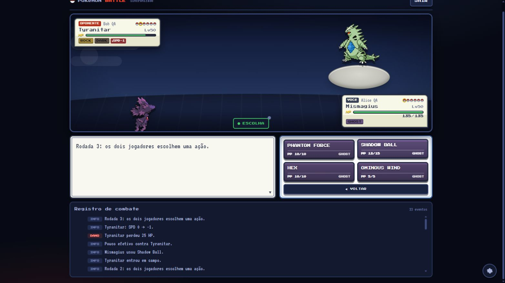
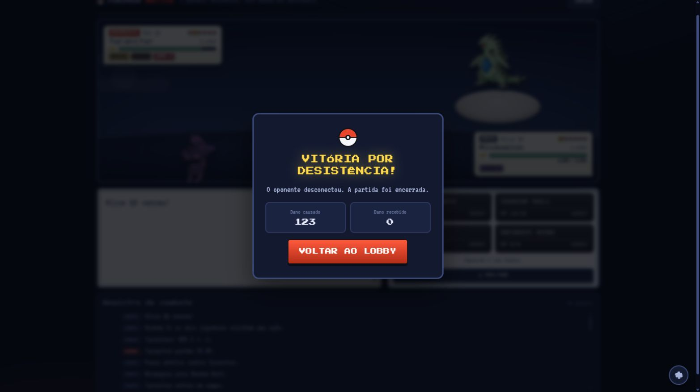

# Fase 3 — integração do motor, protocolo e recursos locais

Data: 2026-10-02. Etapa concluída. A fase 4 continua pendente.

## Entrega

- `Room` passou a orquestrar o `BattleSession` da fase 2B. O simulador é a autoridade
  das regras; não há resolução alternada de ações pelo motor anterior.
- Servidor, React e terminal migraram juntos para `pokemon-battle/3`. Os contratos
  compartilhados validam mensagens em runtime e rejeitam clientes incompatíveis.
- Escolhas simultâneas são privadas, associadas à solicitação atual e a uma chave
  idempotente. ACK e estado de escolha pendente são enviados somente ao autor.
  O React reenvia a mesma ação até três vezes e solicita ressincronização ao esgotar
  as tentativas. O terminal possui o comando `retry`.
- Equipes, golpes, PP, trocas, cargas, recarga e Struggle são derivados das solicitações
  do motor. Trocas intermediárias e revival usam o mesmo contrato de ação.
- Sorteios de equipe, shiny e arena acontecem no servidor, com fluxos de RNG separados
  do combate. Cada lado possui seu fluxo de equipe, independente da ordem de chegada.
- Catálogo de 1.025 espécies base e 954 entradas de golpes empacotado localmente:
  792 golpes compatíveis e 162 bloqueados com motivo. Espécies sem nenhum golpe
  compatível não podem compor a equipe. O learnset é validado também no servidor.
- TERA e terreno de combate foram retirados do fluxo. Arenas preexistentes permanecem
  como ambientação; as seis novas arenas pertencem à fase 6.
- Preparação explícita entre confirmação e batalha: preload de até três segundos,
  até seis carregamentos concorrentes e fallback local. A sala aguarda prontidão
  por oito segundos, configuráveis; ausência de ambos termina sem vencedor.
- Sprites e cries resolvidos por registro local. Strings recebidas pelo socket não
  são interpretadas como URLs, caminhos ou HTML. Áudio começa desligado quando não
  existe preferência salva; escolhas explícitas anteriores são preservadas.
- Falhas internas invalidam o motor e encerram a partida com motivo explícito,
  preservando o último watermark publicado. Desconexão libera sala e timers.

## Evidência de validação

| Verificação | Resultado observado |
|---|---|
| Build final | Servidor e cliente passaram; o build do cliente rejeita inclusão de `@pkmn/sim` ou `@smogon/calc` |
| Lint final | Zero erros; os dois avisos preexistentes de Fast Refresh em BattleProvider e ToastProvider permanecem |
| Suíte completa | Domínio, eventos, auditoria, protocolo, segurança, socket, aplicação, terminal, recursos e motor passaram |
| Matemática preservada | 900 atributos, 324 pares de tipos, 360 cenários de dano × 16 rolls; sanidade 31–37 |
| Regras preservadas | 1.564 cenários de golpes com continuação, 553 resultados de Metronome e 12 partidas completas com replay determinístico |
| Integração HTTP/TCP/WebSocket | Origem/token, catálogo, capacidade, limites, entrada, escolha privada, duplicatas, ações atrasadas, desconexão/reentrada, timeout e partida completa passaram |
| Terminal real | Dois processos do cliente montaram equipes, confirmaram prontidão, enviaram escolhas privadas, receberam dano/novo turno e encerraram por desconexão |
| Ressincronização | Cenário com 70 rodadas ultrapassou a janela de 240 sequências; snapshot e watermark aplicados sem repetir histórico |
| Catálogo sem serviço externo | Escolha, sorteio e preparação exercitados com acesso externo proibido nos testes |
| Recursos locais | 5.125 arquivos conferidos por tamanho e SHA-256; 19.008.688 bytes; nenhuma ausência na importação |
| Preload | Whitelist, limite de seis tarefas, cancelamento sem marcar recursos como falhos e deadline de três segundos mesmo quando o carregador ignora cancelamento |
| Dois navegadores | Duas abas independentes no navegador integrado, usando build de produção: fila, sorteio, montagem, confirmação, prontidão, escolhas, dano, troca e término por desconexão |
| Console do navegador | Nenhum erro ou aviso nas abas inspecionadas durante o fluxo |

A verificação manual usou Mismagius/Gallade e uma troca para Tyranitar. A primeira
escolha bloqueou somente os controles do autor; a resolução ocorreu após a escolha
do outro jogador. Fechar a segunda aba apresentou vitória por desistência na primeira.
O encerramento natural de uma partida completa foi coberto pela integração TCP/WS;
o percurso manual no navegador terminou por desconexão. As abas pertencem ao mesmo
navegador integrado, e não demonstram compatibilidade entre navegadores distintos.

Os testes de privacidade comparam o snapshot completo do adversário antes/depois da
escolha pendente. A integração decodifica as respostas recebidas. Há cobertura de
falha inesperada do motor com mensagem pública genérica e preservação de sequência.
Retries de transporte são cobertos por idempotência/reenvio na integração; não foi
feita simulação manual de perda de pacotes no navegador.

## Migração dos testes anteriores

O runner existente foi mantido e ampliado. Mudanças intencionais de contrato e regra
exigiram adaptar as fixtures; os cenários de regressão continuam representados:

| Cobertura anterior | Adaptação e justificativa |
|---|---|
| Ações alternadas e eventos legados | Escolhas privadas por solicitação, rodada completa e eventos discriminados; execução, PP, status, residual e nocaute continuam verificados |
| Corrida entre fetch de espécie e reset/desconexão | Seleção agora é síncrona e usa catálogo local. Testes verificam atomicidade, duplicatas, reset e ausência de fetch; testes legados de cache, deduplicação, corrupção e retry foram mantidos |
| Log de preparação e equipe inimiga | Verificação de todo o payload, reservas ocultas e acesso por participante; confronto adicional de snapshots antes/depois da escolha privada |
| Rest removendo status e depois adormecendo | O simulador emite a substituição pelo status de sono. Testes conferem cura, sono, turnos sem gasto de PP e falha quando já está saudável |
| Golpe artificial de cura com alteração de atributo | Strength Sap fornece esse comportamento nativo; Heal Pulse e Jungle Healing continuam cobrindo cura do alvo e cura/status |
| Dreno e dano excessivo em múltiplos hits | Extensão isolada de teste, Substitute e False Swipe deixam o alvo com 1 HP; o teste exige dano efetivo 1, cura 1 e um único nocaute |
| Comandos antigos de troca/TERA | Rejeitados deliberadamente pelo protocolo v3. Trocas usam `action`; Terastalização é uma exclusão aprovada |
| Rótulos de efeitos dos golpes | Conversão do índice de crítico nativo para a apresentação legada; Tackle sem rótulo elevado, Leaf Blade com rótulo, chances de Ice Beam/Air Slash e atributo/alvo de Swords Dance verificados |

## Recursos e tamanho do cliente

Os arquivos vendorizados incluem frente, costas, variações shiny e cry de cada espécie.
As revisões de origem, avisos de licença e tratamento do cry de Pikachu com conteúdo
MP3 estão em [créditos dos recursos](../client/public/pokemon/CREDITS.md).
O manifesto registra bytes e SHA-256 por arquivo. A repetição do importador com os
arquivos já presentes reutilizou o cache e terminou sem ausências.

O catálogo compacta learnsets em índices, e o build separa dados para cache independente:

| Arquivo de saída | Tamanho aproximado | Gzip |
|---|---:|---:|
| Aplicação JavaScript | 437,64 kB | 143,81 kB |
| Espécies/learnsets | 487,81 kB | 92,97 kB |
| Golpes/capacidades | 324,31 kB | 34,63 kB |
| Registro de recursos | 181,68 kB | 22,22 kB |
| CSS | 85,25 kB | 25,56 kB |

Nenhum chunk JavaScript supera 500 kB. Os chunks de catálogo ainda são dependências
iniciais; a separação não equivale a carregamento sob demanda. O JavaScript total é
cerca de 1.431,44 kB, ou 293,63 kB gzip. Os 19,01 MB de sprites/cries ficam como
arquivos estáticos e não são todos carregados ao abrir uma batalha; a grade de seleção
usa imagens locais com carregamento preguiçoso. Fontes também são locais.

A ausência de URLs externas nos caminhos ativos foi verificada no código e nas
asserções de recursos. Não foi registrada uma captura completa de tráfego do navegador.
Os módulos legados de PokeAPI/cache permanecem para ferramentas e regressões, fora
do caminho de seleção/combate em produção.

## Organização e limites

As correções anteriores de auditoria foram preservadas separadamente no commit
`34db709` (`fix: preserve audited security and lifecycle baseline`). As fases 2A e
2B permanecem nos commits `c887ea3` e `aeab067`. Servidor, React, terminal, catálogo,
recursos e documentação desta fase são entregues juntos para evitar versões incompatíveis.

A apresentação ainda adapta eventos canônicos à fila visual anterior. HP e troca do
snapshot podem aparecer antes do término da animação: diretor único, confirmação do
estado apresentado, cancelamento/skip, animação de HP e evidência de React Profiler
pertencem à fase 4. Não se afirma ausência de commits React por frame nesta etapa.

Redesenho dos menus, revisão integral de foco/contraste AA/alvos de 44 px, percurso
a 360 px e novas arenas permanecem nas fases 5/6. **60 FPS em celular intermediário
continua [VERIFICAR]**, dependente de medição em aparelho real. A validação automática
do motor não prova todas as combinações possíveis entre golpes.

Próxima etapa: fase 4, somente após a continuação solicitada pelo usuário.
