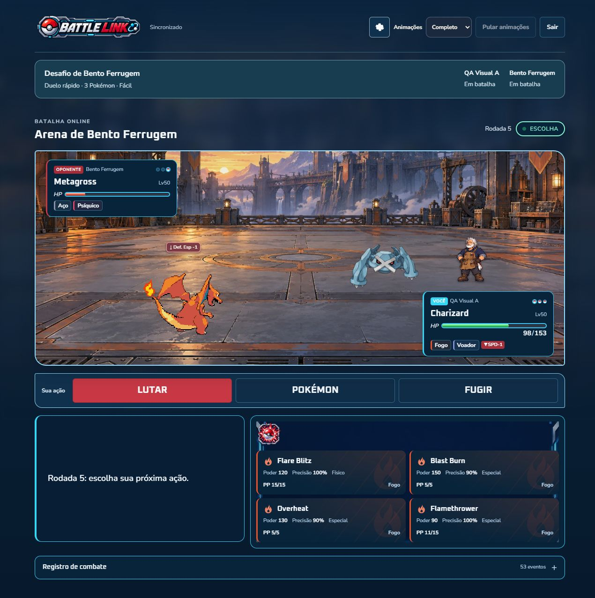

# Frontend e arena — conferência final de 07/10/2026

## Escopo e ponto de partida

Continuação da refatoração visual e da apresentação autoritativa já implementadas.
A árvore começou limpa em `dfb6992`, depois dos commits `7f2c129` e `4ced922`.
As artes, salas privadas, formatos, revanche, treinadores e correções anteriores
foram preservados. Esta etapa corrige problemas encontrados na interface real e
acrescenta o gesto solicitado para ataques da categoria Especial.

`BattleEventQueue` continua ordenando os eventos e o estado apresentado;
`AnimationDirector` continua possuindo os efeitos finitos; `SpriteRenderer`
continua usando atlas locais, cache e relógio compartilhados. Nenhuma dependência,
regra de combate, transporte ou contrato foi alterado nesta etapa.

## Causas e alterações

| Problema | Causa e correção |
| --- | --- |
| Ataques especiais pouco perceptíveis | O gesto genérico era discreto e a família de corte podia selecionar a investida física. `moveProfile` agora identifica a categoria real do catálogo; o diretor aplica preparação, pequeno impulso vertical, brilho moderado e retorno ao corpo do atacante. `Air Slash` usa esse gesto mesmo pertencendo à família corte. |
| Treinadores pareciam fora da arena | A âncora 90%/35% ficava sobre a região distante do cenário. Agora é 82%/62%, ao lado e ligeiramente atrás do adversário em 66%/65%. A camada fica atrás dos Pokémon e HUDs. |
| Configurações cobriam conteúdo | O componente estava fixo no canto inferior, apesar de já ser inserido nos cabeçalhos. Passou a ocupar seu lugar no layout; botão de 44 px e diálogo acessível preservados. |
| Arte invadia o nome na preparação em 360 px | O grid do retrato criava uma coluna implícita com largura mínima do sprite. `minmax(0, 1fr)` permite que a arte respeite os 88 px disponíveis. |

O gesto especial mantém os tempos existentes, usa WAAPI na camada interna,
`fill: none` e o cleanup do diretor. A preferência reduzida desativa o gesto.
Não há impacto antecipado, deslocamento do alvo ou cálculo de resultados no
cliente. Impacto e HP continuam ligados a `damage`; erro, imunidade, crítico,
efetividade, status e contagem de hits dependem dos respectivos eventos.

## Referências e telas revisadas

| Referências enviadas | Implementação e evidência desta rodada |
| --- | --- |
| Logo e tela inicial (#20, #25) | Marca local, três modos, ações e cabeçalho; `home-360/768/1280.png` |
| Partida rápida (#21) | Formulário, formato, monotipo, chave de acesso e ilustração própria; `quick-*.png`, `quick-expanded-360.png` |
| Jogar com amigos (#26) | Criar/entrar por código e apresentação própria; `friends-create-*.png`, `friends-join-360.png` |
| PvE (#24, #27) e referências de personagens | Onze seleções, nomes, assinatura, formatos, dificuldade, fundos e arte individual; `pve-0` a `pve-10-1280.png` |
| Escolha de Pokémon (#23) | Busca, catálogo, ficha, equipe de três, ordem e continuidade reais; `selection-*.png` |
| Preparação de golpes (#22) | Equipados, disponíveis, busca e salvar reais; `setup-fixed-360/768/1280.png` |
| Arena (#1) | HUD, comandos agrupados, quatro golpes 2×2, equipe e registro; `battle-fight-*.png`, `battle-party-*.png` |
| Botões dos 18 tipos (#2–19) | `MoveIdentity` conserva 18 paletas e símbolos locais, texturas discretas, informação HTML e estados de foco/seleção/pressão/indisponibilidade. Registro dos efeitos também distingue os 18 tipos. |
| Pedido de aproximar treinadores | Âncora compartilhada corrigida; `trainer-near-pokemon-360/768/1280.png` |

Todos os arquivos citados estão em [ui-goal-oct7](evidence/ui-goal-oct7/).
As capturas `setup-*` sem `fixed` registram o problema anterior. Capturas de modos,
seleção e `battle-*` foram feitas antes de parte das correções; os arquivos
`home-*`, `pve-*-1280`, `setup-fixed-*` e `trainer-near-pokemon-*` registram seus
respectivos estados corrigidos. A arena final está aqui:

## Arte existente reaproveitada

O inventário em [FRONTEND_VISUAL](FRONTEND_VISUAL.md) contém 12 grupos de menu,
com dois recursos originais distintos por grupo: 24 imagens de interface.
Pares de fundo/painel e destaque/emblema permanecem locais; nenhuma captura de
referência completa foi usada como interface. Marca, dados e controles são
elementos separados. Os prompts, originais, dimensões, alfa e hashes permanecem
nos manifestos e nas fontes de arte do projeto.

PvE usa onze fundos exclusivos e `art.webp` transparente, além de retratos e
atlas próprios. Os atlas atuais medem 960×1200: seis estados, seis frames por
estado, células de 160×200, âncora 80/194; total de 396 frames. Foram reaproveitados
2050 recursos normal/shiny para as fichas e os sprites locais de combate.
Esta rodada não exigiu nova geração de imagens.

## Conferência no navegador

Servidor e cliente executados separadamente; endereço `http://localhost:5173/`.
Viewports: 360×800, 768×1024 e 1280×900.

- Início, rápida, amigos, PvE, seleção, preparação e combate não excederam a
  largura do documento nas medidas registradas. A lista de treinadores tem
  rolagem horizontal própria; o documento não precisa rolar horizontalmente.
- Todos os onze treinadores foram selecionados nos três tamanhos: título,
  seleção `aria-pressed`, identidade e recursos locais conferidos. Carregamento
  tardio dos retratos fora da área visível é esperado.
- Treinador em batalha real com Bento: retângulo inteiramente dentro do campo
  nos três tamanhos, pés perto de 82%/62%, camada 9, sem encobrir os HUDs.
  O laboratório confirmou os limites da mesma âncora nos onze treinadores em
  1280 px; não representa onze partidas reais.
- Retrato corrigido em 360 px: imagem e contêiner de 88×88; 14 px até o nome.
  Em 768 e 1280 px também ficou contido e separado.
- Golpes 2×2: aproximadamente 146×107, 197×118 e 319×94 px, respectivamente.
  Os três comandos de combate permanecem na mesma região.
- Busca e escolha por teclado, remoção/reordenação e preparação de uma equipe
  real de três; troca de Fire Blast por Flamethrower e salvamento confirmado.
- PvE real contra Bento, Duelo/Fácil: Flamethrower consumiu PP, bot respondeu,
  HP/status/atributos e substituições foram apresentados; combate chegou à
  vitória e ao resultado. Última sequência também conferida em movimento reduzido.
- Após sequências, corpos com `transform: none`, `filter: none` e sem estilos
  temporários; após resultado, palco pausado. Preferência restaurada para Sistema.
- Escape fechou o diálogo de áudio e devolveu o foco visível ao botão.

Métricas: [layout](evidence/ui-goal-oct7/ui-metrics.json),
[retratos](evidence/ui-goal-oct7/portrait-geometry.json),
[treinador real](evidence/ui-goal-oct7/trainer-positions.json),
[onze treinadores no laboratório](evidence/ui-goal-oct7/lab-trainer-geometry.json),
[cleanup](evidence/ui-goal-oct7/special-cleanup.json).

## Acessibilidade e pesquisa aplicada

[Apple HIG Layout](https://developer.apple.com/design/human-interface-guidelines/layout/)
orientou alinhamento, agrupamento e dimensionamento sem distorção.
[Apple HIG Buttons](https://developer.apple.com/design/human-interface-guidelines/buttons/)
orientou a ação principal e a separação dos controles.
[WCAG 2.2: alvos](https://www.w3.org/WAI/WCAG22/Understanding/target-size-minimum.html)
orientou a medição mínima de 24 px e o uso de regiões próximas de 44 px.
O checkbox de compatibilidade tem glifo de 17 px dentro de um label acionável
de 44 px de altura; medir apenas o glifo não descreve o alvo efetivo.

[WCAG: contraste](https://www.w3.org/WAI/WCAG22/Understanding/contrast-minimum.html)
orientou texto normal em 4,5:1 e texto grande em 3:1. Medidas das cores base nos
menus e preparação passaram; menor razão nos menus: 5,12:1. Valores modernos
`color(srgb)`/`oklab` foram convertidos conforme
[CSS Color 4](https://www.w3.org/TR/css-color-4/#color-conversion-code).
[Menus](evidence/ui-goal-oct7/contrast-menus.json) e
[preparação](evidence/ui-goal-oct7/contrast-setup.json) registram a coleta.
Gradientes, imagens e todos os estados raros não tiveram análise pixel a pixel;
essas medidas não certificam conformidade integral da aplicação.

A pesquisa de GSAP/WAAPI/Canvas e suas decisões está em
[COMBAT_PRESENTATION_AUDIT](COMBAT_PRESENTATION_AUDIT_2026-10-07.md).
O gesto novo usa a sequência finita, o cancelamento e a preferência compartilhada
já existentes, sem novo relógio ou sistema de animação.

## Verificações e limites

- Runner completo `npm test`: domínio, eventos, contratos, segurança, transportes,
  terminal, edição, recursos, apresentação, renderer, sprites, formatos, salas,
  revanche, bots e motor. Inclui 99 combates de treinador/formato/dificuldade.
- Regressões novas: categoria Especial, gesto nos dois lados e em família corte,
  ausência de impacto antecipado, retorno do corpo, movimento reduzido e proximidade
  da âncora do treinador. O teste de status é isolado antes dos gestos seguintes.
- Builds do servidor e cliente passaram. Lint: zero erros e dois avisos existentes
  de Fast Refresh em `ToastProvider.tsx` e `BattleProvider.tsx`.

As capturas são quadros isolados. A tentativa de registrar o instante intermediário
do gesto especial não produziu prova de sua trajetória completa; os testes verificam
keyframes, participante e cleanup, e a partida real verifica resolução e restauração.
Não houve medição de FPS/memória em celular físico. Nem todo evento raro ou falha
de recurso foi reproduzido em partida real nesta rodada; a cobertura automatizada
e as verificações anteriores estão identificadas nos documentos respectivos.

Capturas antigas permanecem como histórico. As salas continuam em memória e o
servidor permanece autoridade; não houve alteração de mecânicas para produzir arte.
