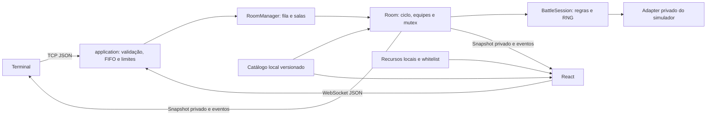

# Arquitetura e demonstração — fase 3

## Fronteiras

- **Transporte:** `application.ts` gerencia sockets, filas por conexão, limites, autenticação, origem e timers. Ambos os clientes usam os mesmos handlers.
- **Orquestração:** `Room` mantém identidades, equipes selecionadas, confirmação, preparação e resultado. O mutex serializa comandos concorrentes; não há consulta externa. O getter `state` só expõe metadados imutáveis.
- **Regras:** `BattleSession` coleta escolhas privadas e resolve a rodada completa com o simulador Gen 9. Apenas o adapter conhece seus objetos mutáveis. Snapshots/eventos retornados são imutáveis.
- **Dados:** catálogo gerado da versão fixada de `@pkmn/sim`; espécies e golpes são JSON separados, learnsets usam índices compactos no disco. Cliente e servidor usam a mesma versão.
- **Recursos:** sprites/cries locais são resolvidos por mapas; mensagens nunca fornecem caminhos. Whitelist impede interpretar URL/HTML recebido. O bundler rejeita simulador/calculadora no navegador.
- **Apresentação:** `BattleProvider` mantém snapshot autoritativo e entrega um modelo visual separado por `presentSnapshot`. O adaptador de eventos usa sequência estável; a sincronização de HP com conclusão de animações pertence à fase 4.

A ordem de chegada das escolhas não decide quem ataca primeiro: prioridade, velocidade e desempate do RNG fazem isso. O primeiro jogador recebe confirmação privada; a transmissão pública só ocorre após a resolução. Desconexão produz resultado final antes de remover e destruir a sala. Timer de preparação, sockets e motor são liberados no encerramento.

Combate, sorteio de equipes e apresentação têm fluxos de RNG separados. Sorteio por lado tem fluxo próprio, de modo que a ordem de cliques dos dois jogadores não muda sua seleção. Arena usa somente o fluxo visual. Não há alterações de RNG global.

## Roteiro de apresentação

1. Inicie servidor e dois terminais ou duas abas React; veja waiting e match_found.
2. Sorteie seis membros em cada cliente; ajuste golpes compatíveis e confirme.
3. Verifique a preparação dos recursos antes do início.
4. Escolha uma ação em um cliente: seus controles ficam aguardando, a visão adversária não muda.
5. Escolha no outro cliente; observe a rodada completa, PP, HP e eventos coerentes nos dois lados.
6. Demonstre troca voluntária e, após KO, substituição obrigatória.
7. Reenvie a mesma ação: não executa novamente. Solicitação antiga ou troca da equipe adversária falha.
8. Termine a batalha ou feche uma conexão: o resultado final chega antes da liberação da sala.

Detalhes de contrato: [protocolo](protocolo.md). Evidências e limites de etapa: [fase 3](FASE_3_INTEGRACAO.md).
