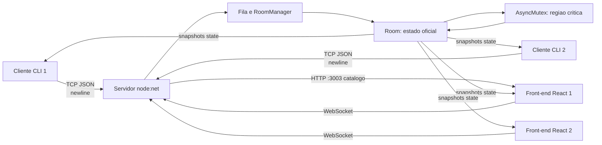

# Arquitetura e demonstracao

O recurso compartilhado e `Room.state`: jogadores, Pokemon, HP, energia, turno, log e vencedor. A regiao critica comeca quando `room.mutex.acquire()` resolve e termina no `finally` com `unlock()`. Escolha de Pokemon e acao de batalha so modificam o estado dentro desse intervalo.

O Node executa handlers no event loop, mas isso nao substitui a demonstracao: o `AsyncMutex` serializa explicitamente mensagens concorrentes que chegam para a mesma sala. Se dois ataques chegarem juntos, o primeiro lock adquirido valida seu turno e altera o estado; o segundo espera, depois recebe erro de turno ou processa o novo estado, sem intercalar mutacoes.

O front-end React consome a ponte WebSocket (porta 3002) e o catalogo por HTTP (porta 3003); ele nunca calcula dano, turno ou vencedor - apenas exibe os snapshots e reage a eventos derivados por diff (animacoes GSAP, particulas e sons).

## Roteiro de apresentacao

1. Terminal 1: `npm start`. Mostre as conexoes TCP, a ponte WebSocket e as linhas `[mutex]`.
2. Terminais 2 e 3: `npm run client -- Alice` e `npm run client -- Bob` (ou duas abas do front-end em `http://localhost:5173`).
3. Mostre `waiting`, `match_found`, os dois jogadores e o estado central.
4. Em ambos, escolha um Pokemon. O servidor transmite o mesmo snapshot.
5. Tente atacar no cliente que nao tem o turno para mostrar a rejeicao.
6. Ataque no turno correto e mostre HP, log e troca de `turn` nos dois lados (no front, com animacoes e sons).
7. Envie uma mensagem invalida para mostrar a resposta de protocolo.
8. Repita ataques ate `phase: finished` e `winner`, ou feche um cliente para mostrar `opponent_left`.