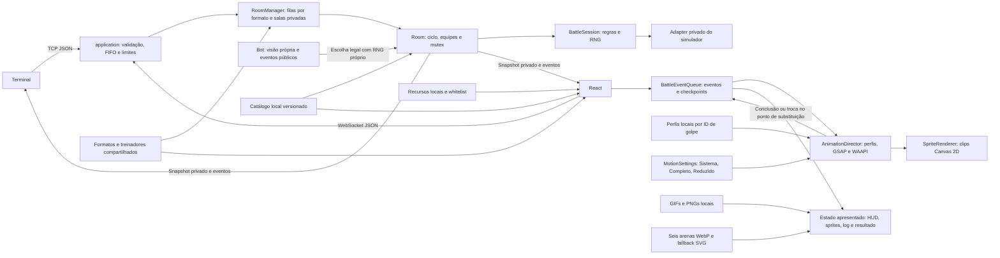

# Arquitetura e demonstração — fases 5–7 e Frontend Refresh

Mapa ativo em 2026-10-03, com a reformulação **Battle Link** e protocolo `pokemon-battle/4`. As regras Gen 9 permanecem sob autoridade do servidor; menus, arenas e animações pertencem à apresentação. [Entrega de modos e treinadores](MODOS_E_TREINADORES.md).

## Fronteiras

- **Lobby e formatos:** autenticação registra a identidade sem entrar na fila. `RoomManager` indexa filas por formato/tipo, convites e participantes. `roomId` permanece na revanche; uma nova `Room` e um novo `matchId` representam cada combate. Códigos têm oito caracteres aleatórios e expiram por inatividade; limites de admissão usam conexão e IP. `application` cancela timers ao remover uma sala.
- **PvE:** `trainers.ts` fixa os loadouts do catálogo local. O bot ocupa p2 e passa pelo mesmo caminho de validação e solicitações. `bot.ts` recebe apenas sua perspectiva e eventos visíveis, com orçamento determinístico de operações; decisões têm RNG separado. `application` programa uma decisão por solicitação, verifica se a partida ainda existe e utiliza o mutex. Falha de avaliação usa uma escolha legal.
- **Revanche:** votos têm prazo de 30 segundos e retenção individual de equipes. Toda condição de combate vem de um motor novo. Ações, montagem e preparação são vinculadas ao `matchId`, impedindo reutilizar comandos de uma batalha encerrada. Os códigos privados permanecem até a saída do criador ou expiração.
- **Treinadores visuais:** 55 WebP locais: arte, retrato, atlas anterior, splash e atlas de movimento para cada um dos 11 treinadores. O manifesto declara 12 células de 160×200 por atlas de movimento, seis estados com dois quadros e âncora 80/194. `TrainerArt` usa a splash e a assinatura local no PvE; `TrainerSprite` apresenta idle/preparo/arremesso/reação/celebração/derrota. `AnimationDirector` mantém os Pokémon ocultos até a saída do treinador e limpa esse bloqueio ao concluir, cancelar ou pular. Nenhuma imagem do socket é interpretada como caminho.

- **Transporte:** `application.ts` gerencia sockets, filas por conexão, limites, autenticação, origem e timers. Ambos os clientes usam os mesmos handlers.
- **Orquestração:** `Room` mantém identidades, equipes selecionadas, confirmação, preparação e resultado. O mutex serializa comandos concorrentes; não há consulta externa. O getter `state` só expõe metadados imutáveis.
- **Regras:** `BattleSession` coleta escolhas privadas e resolve a rodada completa com o simulador Gen 9. Apenas o adapter conhece seus objetos mutáveis. Snapshots/eventos retornados são imutáveis.
- **Dados:** catálogo gerado da versão fixada de `@pkmn/sim`; espécies e golpes são JSON separados, learnsets usam índices compactos no disco. Cliente e servidor usam a mesma versão.
- **Recursos:** sprites/cries locais são resolvidos por mapas; mensagens nunca fornecem caminhos. Há 3.368 GIFs para 868 espécies e fallback PNG para variantes ausentes. Seis arenas ilustradas WebP mantêm os seis SVG anteriores como fallback. Atlas de efeitos, fontes, ícones e áudio também são locais. Whitelist impede interpretar URL/HTML recebido. O bundler rejeita simulador/calculadora no navegador.
- **Apresentação:** `BattleProvider` mantém o snapshot autoritativo usado para validar controles. `BattleEventQueue` recebe eventos novos, preserva checkpoints de cada snapshot e confirma fatos visuais após a conclusão do `AnimationDirector`. HP, ativo, status, log e resultado usam esse estado apresentado. Uma lacuna, skip ou aba oculta aplica o snapshot mais recente e cancela trabalho obsoleto. A troca confirma o novo ativo depois da saída e antes da entrada.
- **Animações:** `moveProfiles.ts` escolhe famílias artísticas por ID canônico, com fallback baseado em dados locais. O diretor coordena movimento corporal GSAP/WAAPI e os clips Canvas 2D do `SpriteRenderer`, cujo relógio e cache são compartilhados. GIFs fornecem os quadros corporais disponíveis; perfis e atlas fornecem efeitos reutilizáveis. Nenhum desses componentes calcula regras de combate ou publica estado React por frame.
- **Preferências:** `MotionSettings` oferece Sistema, Completo e Reduzido. Sistema acompanha a preferência do sistema operacional; a escolha explícita é persistida quando possível. A apresentação reduzida usa sprites/indicadores estáticos e continua aplicando os eventos oficiais. Áudio começa desligado sem preferência salva.
- **Interface:** tokens e CSS Modules compõem superfícies em azul profundo com acentos vermelho/ciano e contraste da arena ativa. `MENU_ART` associa 24 imagens exclusivas aos 12 menus; `MenuArt` integra cenários, emblemas e marca raster. `MoveIdentity` usa 18 símbolos SVG locais. `ButtonSkin` acrescenta duas molduras SVG estáticas da Kenney (CC0), via nove partes, aos golpes e três comandos, sem preencher o centro ou executar loops. Textos e controles continuam HTML. `TeamEditor` compartilha remoção, reordenação e anúncio da ordem entre seleção e golpes. Oxanium e Nunito Sans são locais com Latin/Latin Ext; formatação e busca não alteram IDs enviados ao servidor. Em notebooks curtos, arena/ações usam duas colunas e catálogos têm rolagem própria. Evidências em [skin e notebooks](button-art-notebook.md).

A ordem de chegada das escolhas não decide quem ataca primeiro: prioridade, velocidade e desempate do RNG fazem isso. O primeiro jogador recebe confirmação privada; a transmissão pública só ocorre após a resolução. Desconexão produz resultado final antes de remover e destruir a sala. Timer de preparação, sockets e motor são liberados no encerramento.

Combate, sorteio de equipes e apresentação têm fluxos de RNG separados. Sorteio por lado tem fluxo próprio, de modo que a ordem de cliques dos dois jogadores não muda sua seleção. Arena usa somente o fluxo visual do servidor. Partículas do cliente derivam sua variação da sequência pública, sem receber a seed privada ou consumir o RNG de combate. Não há alterações de RNG global.

## Laboratório e medição

`/visual-check` é carregado sob `import.meta.env.DEV` ou `--mode profile`: cenário do motor real, galeria dos 24 clips, seis arenas e prévias responsivas. O cenário força movimento completo apenas para inspeção. O jogo mantém a preferência escolhida. O build normal exclui laboratório, fixture e galeria.

**React Profiler só fica ativo no modo profile**, que usa React DOM profiling. Abrir o laboratório em DEV comum permite inspeção visual, mas não produz essa instrumentação. Evidências da versão atual ficam em [Frontend Refresh](FRONTEND_VISUAL.md); as medições históricas não certificam o refresh. FPS e memória em aparelho real continuam **[VERIFICAR]**.

## Roteiro de apresentação

1. Em dois terminais, execute `npm run dev` dentro de `server/` e dentro de `client/`. Abra **http://localhost:5173/** em janelas normal e anônima, com nomes diferentes; escolha Partida rápida, o mesmo formato/tipo e aguarde o pareamento, ou compartilhe um convite privado.
2. Sorteie três ou seis membros conforme o formato; ajuste golpes compatíveis e confirme.
3. Verifique a preparação dos recursos antes do início.
4. Escolha uma ação em um cliente: seus controles ficam aguardando, a visão adversária não muda.
5. Escolha no outro cliente; observe a rodada completa, PP, HP e eventos coerentes nos dois lados.
6. Demonstre troca voluntária e, após KO, substituição obrigatória.
7. Reenvie a mesma ação: não executa novamente. Solicitação antiga ou troca da equipe adversária falha.
8. Termine a batalha ou feche uma conexão: o resultado final chega antes da liberação da sala.

Passo a passo de execução: [Como jogar](COMO_JOGAR.md). Detalhes de contrato: [protocolo](protocolo.md). Interface atual e limites: [Frontend Refresh](FRONTEND_VISUAL.md). Histórico preservado: [fase 3](FASE_3_INTEGRACAO.md), [fase 4](FASE_4_APRESENTACAO.md) e [validação das fases 5–7](FASES_5_6_7_VALIDACAO.md).

Recursos atuais e evidências desta entrega: [Modos e treinadores](MODOS_E_TREINADORES.md).
