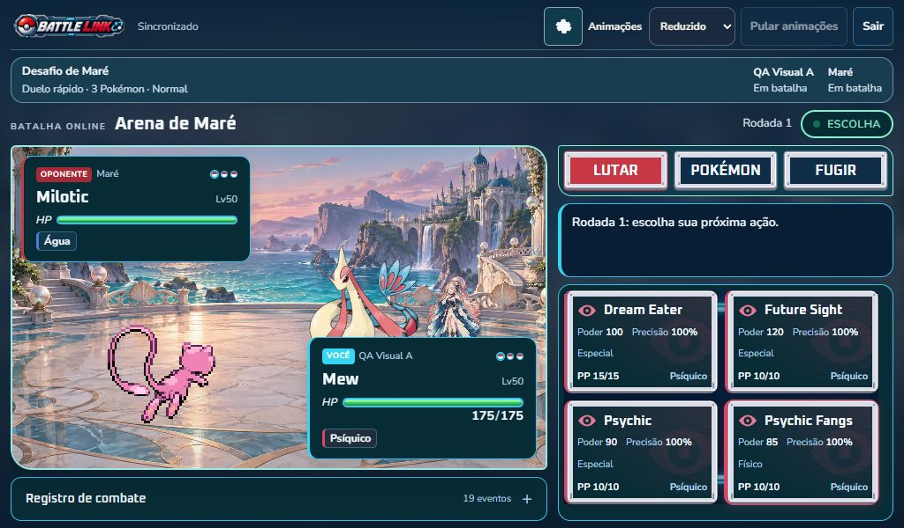
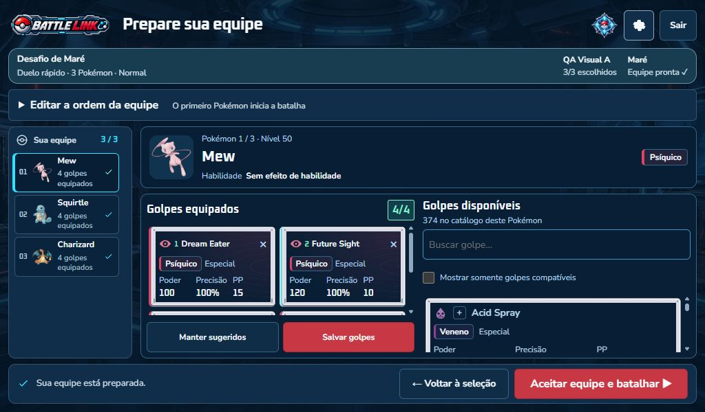

# Skin discreta dos botões e interface para notebooks

## Entrega atual — 8 de outubro de 2026

O pedido de 126 quadros individuais foi cancelado. Foram retirados os quadros dessa experiência, galeria, reprodução, cache, listeners, empacotador e testes da sequência. Os originais do imagegen fora do projeto foram preservados; uma cópia adicional da experiência foi guardada no diretório temporário do Windows antes da remoção.

As cores, 18 símbolos vetoriais, controles HTML e handlers anteriores permanecem. A decoração atual usa **duas imagens estáticas**, sem dependências novas ou geração de arte. Foram preservados os ajustes de notebooks, menus, arena e treinadores.

## Recursos e integração

Fonte oficial: [Kenney UI Pack Sci-Fi 2.0](https://kenney.nl/assets/ui-pack-sci-fi), licença **CC0**. Licença original e manifesto estão em `client/public/interface/button-skins`. Os SVG foram copiados sem alteração de `Vector/Extra`.

| Estado | Recurso | Dimensão | Bytes | SHA256 |
| --- | --- | --- | --- | --- |
| Repouso | `button_rectangle_depth.svg` | 192×64 | 2.692 | `ec326f1d6f355509beb873e6ac9cb711bb378b275039abdfbb7163bc3737801b` |
| Pressionado | `button_rectangle.svg` | 192×64 | 2.065 | `7286203d0c790e20309e6cd9cc96290f8a0d8927c348ae942e476ee32fc7e11e` |

As duas imagens somam **4.757 bytes**. `ButtonSkin.module.css` usa `::before`, `pointer-events: none`, corte 14 e borda visual de 7 px, sem preencher o centro. Nome, tipo, categoria, poder, precisão e PP continuam HTML. A skin está nos golpes do combate/preparação e em Lutar/Pokémon/Fugir. O navegador antecipa a imagem de pressionamento.

- Destaque: brilho discreto da cor do tipo/comando. Pressionamento: moldura plana e deslocamento de 1 px. Nenhuma reprodução contínua, timer ou atualização React por frame.
- Seleção: contorno interno estável, mantido no destaque. Nos golpes de combate, exige submissão confirmada no pedido correspondente; outro pedido limpa o marcador. Foco tem contorno independente.
- Indisponibilidade preserva `disabled`, PP e ações legais. Recarga só recebe esse rótulo quando o servidor declara `lockedMoveId: recharge`.
- Movimento reduzido conserva `transform: none` e transição `0s`, inclusive durante pressionamento. Não há reprodução de skin para cancelar ao ocultar a aba ou desmontar.
- Se o SVG faltar, superfície, símbolos, texto, foco e handler HTML continuam disponíveis.

### Pesquisa aplicada

[border-image na MDN](https://developer.mozilla.org/en-US/docs/Web/CSS/Reference/Properties/border-image) e [NineSlice no Phaser](https://docs.phaser.io/api-documentation/class/gameobjects-nineslice/) orientaram os cantos preservados, sem instalar Phaser. [Foco visível](https://developer.mozilla.org/en-US/docs/Web/CSS/Reference/Selectors/:focus-visible) orientou o contorno próprio; [movimento reduzido](https://developer.mozilla.org/en-US/docs/Web/CSS/Reference/At-rules/@media/prefers-reduced-motion) orientou a ausência de deslocamento/transição. [Media queries](https://developer.mozilla.org/en-US/docs/Web/CSS/Guides/Media_queries/Using) combinam largura e altura para o notebook.

## Notebooks e problema corrigido

Largura ≥980 px e altura ≤800 px ativam a composição compacta. Formulários são compactos; seleção mantém seis integrantes numa linha; preparação tem rolagem própria e ordem inicialmente recolhida. Arena/registro ficam à esquerda, comandos/golpes à direita. Em larguras menores, o fluxo é vertical. O atalho **Revisar e confirmar ↓** continua disponível na preparação.

A inspeção encontrou cartões equipados com 88 px para conteúdo de 118 px, cortando os valores dos golpes. As linhas agora crescem pelo conteúdo e a lista rola separadamente. Os quatro cartões medidos ficaram com `clientHeight === scrollHeight`, mantendo Salvar e Confirmar acessíveis.

A conferência final recuperou também as superfícies e marcas d’água originais na preparação. Nomes como Honchkrow revelaram outra sobreposição na lista lateral: a largura limitada quebrava o texto dentro de linhas menores que seu conteúdo. A composição interna desses itens agora usa grid e as linhas crescem pelo conteúdo. `setup-restored.json` e as sete capturas `setup-restored-*` registram a apresentação final, sem corte nos integrantes ou golpes. As capturas anteriores de preparação nesta pasta precedem esse ajuste final.

## Evidência atual

Capturas e medidas em [evidence/button-skins](evidence/button-skins/). Foram conferidos início, rápida, amigos monotipo, entrada por código, PvE, seleção com seis membros, preparação e combate nas sete dimensões, sem rolagem horizontal nas medições.

| Janela | Limite inferior dos quatro golpes | Salvar na preparação | Confirmar na preparação |
| --- | --- | --- | --- |
| 1024×600 | 573,47 px | 513 px | 581 px |
| 1280×720 | 525,50 px | 633 px | 701 px |
| 1366×650 | 525,50 px | 563 px | 631 px |
| 1366×768 | 525,50 px | 681 px | 749 px |
| 1440×800 | 525,50 px | 713 px | 781 px |
| 360×800 | Fluxo vertical com rolagem | Por rolagem | Por rolagem/atalho |
| 768×1024 | Fluxo vertical com rolagem | Por rolagem | Por rolagem/atalho |

Comandos: 46 px nos notebooks, 44 px em 360 px e 51 px no tablet. Golpes inspecionados sem conteúdo cortado. Salvar/Confirmar: 44 px na preparação 1024×600.

### Fluxos reais e dados simulados

- PvE real, Maré/Normal/Duelo: Mew, Squirtle e Charizard. Hydro Pump foi substituído por Aqua Jet, salvo e apresentado com PP 20/20 na batalha. Pokémon abriu a troca; Squirtle entrou. Hydro Cannon por Enter produziu **Recarregar / Recarga** na Rodada 3. Fugir voltou ao início.
- Os 18 tipos foram encontrados no catálogo de Mew, com símbolo correspondente e skin local aplicada: `18-types.json`.
- Uma página temporária com componentes reais e **dados simulados** verificou PP zero e incompatibilidade desabilitados; Enter acionou uma ação, bloqueou a grade e marcou a seleção confirmada; o pedido seguinte limpou o marcador. Não se afirma batalha real com PP esgotado.
- Nome longo em 360×800 sem corte/rolagem horizontal; movimento reduzido com `transform: none`, transição `0s` e animação decorativa `none`.
- Moldura deliberadamente ausente na página temporária: texto/símbolos permaneceram e Enter acionou o handler. A página foi removida após a conferência. Registros: `simulated-states.json`, `reduced-and-fallback.json`, `reduced-final.json`.

`evidence/button-notebook` pertence à etapa anterior e é preservado como histórico; não comprova a skin atual. Pressionado/destaque têm regras CSS inspecionadas; não se apresenta captura de repouso como prova de um pressionamento mantido.

## Verificações e limites

Runner completo aprovado: contratos v4, segurança, rede/terminal, equipe, recursos, apresentação, áudio, sprites, modos, revanche, bots e motor; inclui 99 batalhas automáticas de treinador/formato/dificuldade. O teste novo confere licença, dois SVG, bytes, SHA256, geometria, corte/borda, integração, retirada da reprodução antiga e regressão da altura compacta. Builds passaram; lint sem erros, com dois avisos anteriores de Fast Refresh.

Nenhum protocolo, regra, motor ou dependência foi alterado. Não foram comprovados zoom real de navegador em 125%/150%, contraste de todos os estados, desempenho em notebook/celular físico ou toque real. Multiplayer foi coberto pelo runner; a conferência manual de batalha desta entrega foi PvE.
